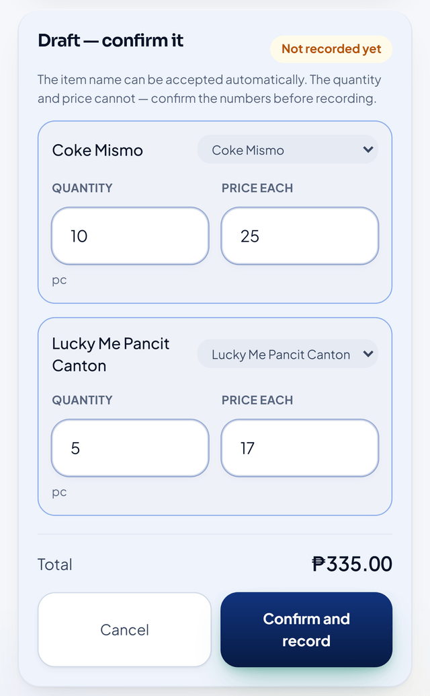
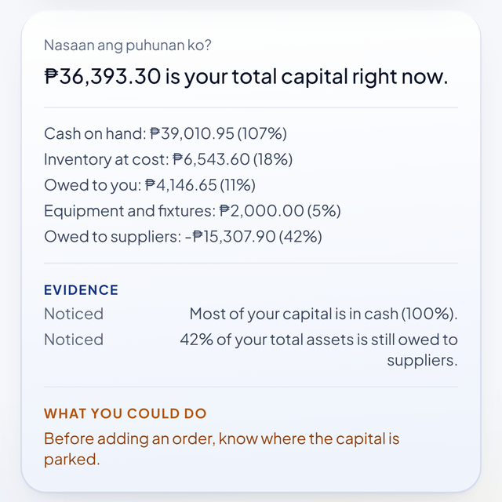
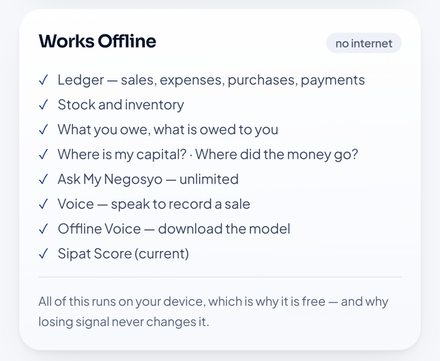

^ **PHILIPPINE STARTUP CHALLENGE XI**
^ **TEAM NAME: SIPAT LABS**
^ **STARTUP NAME: SeePat**
^ **CONCEPT NOTE**

## I. SUMMARY

SeePat is derived from SIPAT — Smart Insights for Profit, Assets and Trade. The name draws from the Filipino word *sipat*, meaning to look closely, observe, check, or assess carefully. This reflects SeePat's purpose: helping microentrepreneurs look beyond daily sales and understand what is actually happening in their businesses.

SeePat is a proposed voice-first financial and business decision-intelligence platform designed for Filipino microentrepreneurs, including sari-sari store owners, carinderias and food stalls, public-market vendors, home-based sellers, neighborhood retailers, and other owner-managed microbusinesses.

The startup addresses a practical problem: knowing how much was sold does not necessarily mean knowing how much was earned, where working capital went, how much is tied up in customer credit, or what should be restocked. Sales, expenses, inventory, utang, and capital are often recorded separately or remembered informally.

> "Magkano talaga ang kinita ko?"
> "Nasaan ang puhunan ko?"
> "Bakit mataas ang benta pero kulang ang cash?"
> "Magkano ang nasa utang?"
> "Ano ang mabilis at mabagal mabenta?"
> "Ano ang dapat kong i-restock?"

SeePat proposes a Voice-to-Business interaction model that converts natural Filipino or English business speech into validated, structured transaction records. For example, an owner may say, "Nakabenta ako ng sampung Softdrinks, tig-bente." The proposed system will interpret the statement, ask for confirmation when needed, record the transaction, update related business records, and feed verified data into deterministic financial computations.

SeePat is not positioned as another Point-of-Sale system. Its primary value is helping entrepreneurs understand what their business numbers mean and use those numbers to make better decisions: POS records what happened; bookkeeping calculates what happened; SeePat is designed to help explain why it happened, where the money went, and what the entrepreneur should consider doing next.

**Current Development Stage: working prototype, pre-MVP.** SIPAT LABS has defined the problem, target users, value proposition, business model, core workflows, product architecture, feature scope, and prototype design. Beyond design, a working mobile-first prototype has been built and is demonstrable end to end: it runs in the browser and installs as an app, and it already records sales (cash and *utang*), purchases, operating expenses, customer payments, capital injections, withdrawals, and stock adjustments; maintains inventory at moving weighted-average cost; computes profit, cash position, receivables, and where working capital currently sits; explains each of those figures in Filipino or English; and answers the owner's questions such as *"Nasaan ang puhunan ko?"* with the figures behind the answer. Every financial value is produced by fixed, tested arithmetic rather than by a language model, and the prototype is covered by an automated test suite (169 automated tests at the time of writing) that asserts the accounting identities after every transaction. The prototype works with no internet connection, and voice capture has an on-device option — a Whisper-class model, MIT-licensed, downloaded once with the owner's consent — that transcribes on the phone itself. What is *not* yet delivered is the externally usable MVP: accounts, cloud backup, first-run onboarding for owners who are not the team, and the pilot release. Problem validation, prototype validation, MVP hardening, controlled testing, and pilot deployment therefore remain the succeeding milestones, and Section IX states them with dates.

## II. BACKGROUND OF THE PROBLEM

Micro, small, and medium enterprises (MSMEs) constitute a vital pillar of the Philippine economy, contributing significantly to entrepreneurship, employment, and local economic activity. According to government-reported 2024 MSME statistics, MSMEs comprise 1,236,908 establishments, representing 99.63% of all business establishments in the Philippines. Microenterprises alone account for 1,125,476 establishments, or 90.66% of the total, underscoring their dominant presence in the country's business landscape. These figures highlight the critical role of microenterprises and the importance of strengthening their capacity, productivity, resilience, and long-term sustainability. (Source: Philippine Information Agency (PIA), citing DTI/PSA 2024 MSME statistics)

Despite their economic importance, many microentrepreneurs continue to operate with limited financial-management and digital decision-support capabilities. DTI's baseline survey on MSME digitalization found that **23% of surveyed MSMEs did not use ICT tools for business at all, 51% used only basic tools, and only 6% used advanced digital tools; 73% reported a need for capacity building, particularly in financial management, customer development, and content management.** (Source: Department of Trade and Industry, Baseline Survey on Digitalization of MSMEs in the Philippines, September 2020)

For many small neighborhood businesses, the challenge is not simply the absence of technology. The deeper problem is the disconnect between everyday transactions and actionable business understanding.

Traditional notebooks, calculators, memory-based recording, and fragmented digital records make these questions difficult to answer consistently.

Existing digital POS and bookkeeping applications have significantly improved transaction recording, inventory management, and financial reporting. However, this creates another opportunity: helping entrepreneurs interpret their business information without requiring them to become accountants, analysts, or expert users of complex dashboards.

Government programs promoting sari-sari store and MSME digitalization further demonstrate the relevance of developing accessible digital solutions for this sector. (Department of Trade and Industry. Tindahan Mo, e-Level Up Mo!)

Two further constraints shape the problem and the design that follows. First, **a records gap is also a financing gap.** Cooperatives, microfinance institutions, and banks ask for evidence of sales, expenses, and receivables before extending credit. A microbusiness that keeps no records cannot produce that evidence, and therefore pays more for capital, borrows informally, or does not borrow at all. Second, **connectivity and data cost are real.** Many target users operate in places with intermittent signal and pay for mobile data by the megabyte, so a tool that must reach a server before it can answer "Magkano ang kinita ko ngayon?" will not be opened at the moment the answer matters.

The opportunity is therefore not merely to digitize transactions, but to make business data understandable and actionable for owners who may not have accountants, analysts, or sophisticated business systems — with the record and the answer staying on the owner's own phone.

## III. PROPOSED STARTUP SOLUTION

SeePat is a mobile-first, voice-first financial and business decision-intelligence platform designed around a simple operating cycle:

> SPEAK / RECORD → VALIDATE → COMPUTE → UNDERSTAND → PREDICT → DECIDE

The system combines structured business recording, deterministic financial computations, natural-language processing, speech recognition, analytics, forecasting, and explainable AI.

**One architectural rule governs all of it: arithmetic computes every financial figure, and AI may only interpret or phrase them.** Every number SeePat shows — profit, cash, inventory value, receivables, capital position, and the Sipat Score — is produced by fixed, versioned formulas applied to the owner's own records, and is reproducible: the same records always produce the same answer. Language AI is confined to understanding speech, detecting patterns, and generating explanations; it is never the source of a peso value. Two consequences matter to a government and institutional audience: **the numbers cannot be hallucinated**, and **the product does not need an AI service to work.**

**By default, the owner's data does not leave the phone.** The prototype keeps the ledger on the device, requires no account, and answers questions with no internet connection; no server in the current architecture holds sales or customer data. Voice capture uses either the browser's recognizer, when online, or an on-device Whisper-class model (MIT-licensed) downloaded once with the owner's consent. This is privacy by architecture rather than by policy, and it is also why the product remains usable where signal is intermittent and mobile data is expensive. Cloud backup, multi-device access, and institutional dashboards are deliberately positioned as server-dependent paid features (Section VII), so the free tier costs the owner nothing and costs SeePat nothing to serve.

**What SeePat is not.** SeePat is a management-accounting and decision-support tool. It is not a BIR-registered point-of-sale system and does not issue official receipts; it does not replace a business's books of record or its compliance obligations. Where those are required, SeePat is designed to export records in a form the owner or their bookkeeper can use.

**Where SeePat is behind today, and what we are doing about it.** Naming this is part of the proposal, not a footnote.

- **Payments and e-wallet reconciliation.** Competing platforms connect to payment channels; SeePat records sales but does not yet reconcile GCash, Maya, or card settlements.
- **Retail hardware.** Receipt printers, barcode scanners, and cash drawers are supported by mature POS products and are out of scope for a phone-first tool.
- **Distribution footprint.** Peddlr states that it has helped more than two million Filipino stores, and Packworks' network is reported at over 270,000 sari-sari stores; SeePat has no users yet.
- **Our response** is not to match those features but to win where they are weak: an owner who is not an accountant, a phone rather than a counter, intermittent signal, and questions about *profit and capital* rather than about sales recording.

### A. Voice-to-Business

A key proposed innovation of SeePat is Voice-to-Business. Rather than treating speech recognition merely as voice-to-text, SeePat is designed to transform natural business speech into structured and actionable business information. The proposed process is:

> Speech → Transcription → Intent Recognition → Entity Extraction → User Validation → Structured Transaction → Financial Computation → Business Record → Insight

For example: *"May utang si Aling Nena — dalawang sardinas at isang kilong asukal."* SeePat may identify:

- Customer: Aling Nena
- Transaction: Credit Sale
- Items: 2 sardines + 1 kg sugar
- Payment Status: Receivable / *Utang*

After user confirmation, the transaction can automatically update sales, inventory, customer receivables, and the business's financial position.

Voice interaction is intended to reduce the friction associated with conventional bookkeeping interfaces, particularly for entrepreneurs who are accustomed to managing their businesses conversationally and informally. Manual forms remain available for users who prefer conventional input or when voice recognition is uncertain. Two safety rules are designed into the workflow: **the recognizer is constrained to the items the store actually sells**, and **quantities and prices never post automatically** — voice produces a draft that the owner confirms, because a misheard item is visible on screen while a misheard quantity would silently corrupt every downstream insight.

### B. SeePat Ledger

Records and organizes sales, purchases, operating expenses, cash inflows, cash outflows, and transaction history.

### C. SeePat Stock

Provides inventory visibility into current stock, inventory movement, fast and slow-moving products, low-stock indicators, estimated stock depletion and proposed replenishment guidance.

### D. SeePat Utang

Tracks customer receivables, outstanding balances, payments, aging of *utang*, and total capital currently tied up in receivables.

### E. SeePat Capital — "Nasaan ang Puhunan Ko?"

This is one of SeePat's signature features. It helps the owner understand how working capital is distributed across cash, inventory, receivables, and relevant liabilities rather than showing cash alone. This helps answer: *"Nasaan ang puhunan ko?"*

For example, SeePat may explain: *"Your available cash decreased this week because ₱3,200 remains in customer receivables while ₱5,600 was used to replenish inventory. A significant portion of your working capital is therefore currently held in inventory and utang rather than cash."*

The two questions that owners ask about capital are kept deliberately separate, because they have different answers: **composition** — *"Nasaan ang puhunan ko?"* — where capital sits right now (assets only; expenses and withdrawals are not locations), and **provenance** — *"Saan napunta ang pera ko?"* — how capital was built and consumed since the business began. Both are guaranteed consistent because both reduce to one identity, which the prototype asserts after every transaction:

> Assets − Liabilities = Capital Injected − Withdrawals + Cumulative Net Profit

### F. SeePat Insights

Converts verified records into understandable explanations of sales, expenses, profit, inventory, receivables, cash position, and capital allocation. Instead of simply presenting:

> Sales: ₱8,420 | Expenses: ₱5,730

the platform may explain: *"Sales increased this week, but estimated profit did not increase at the same rate because product acquisition and operating expenses also increased."*

The purpose is to move from data display to business understanding.

### G. SeePat Score

A proposed explainable business-health indicator combining selected operational and financial signals such as profitability, cash position, receivable exposure, inventory movement, expense behavior, and sales trends. The score will not be presented as a substitute for professional financial assessment. Its purpose is to provide entrepreneurs with a simplified indicator of areas requiring attention, together with an explanation of the factors influencing the score.

The score is a **versioned, decomposable calculation**, not an opaque number: each dimension publishes its weight, its own score, its contribution to the headline figure, and a plain-language explanation, so the same records always produce the same score and the owner can see exactly which dimension moved it.

### H. Ask SeePat

Users can ask natural-language questions such as:

> "Magkano kinita ko ngayong linggo?"
> "Bakit bumaba ang tubo ko?"
> "Magkano ang nasa utang?"
> "Ano ang pinakamabilis mabenta?"
> "Ano ang matagal nang hindi gumagalaw?"
> "Nasaan ang puhunan ko?"
> "Ano ang dapat kong i-restock?"

The system retrieves the relevant verified business records, performs the required calculations, and generates a simplified explanation. Every answer carries the figures that produced it, and the answering layer runs on the device, which is why it works offline and costs nothing per question.

### I. Explainable Decision Intelligence

Recommendations will be accompanied by evidence and the business factors behind them. Instead of: *"Restock Softdrinks."* SeePat will provide an explanation such as: *"Softdrinks averaged 18 units sold per day during the last seven selling days. You currently have 12 units remaining. At the recent sales rate, your inventory may be depleted within one selling day."* This approach allows the entrepreneur to understand why a recommendation was generated.

### J. Business Twin

Each verified transaction updates a simplified digital representation of the enterprise covering sales, expenses, cash, inventory, receivables, payables, and profitability. This Business Twin becomes the foundation for financial calculations, conversational queries, business-health indicators, forecasts, and recommendations. It is reconstructed from the transaction log rather than maintained by hand, so a correction or a void is reproducible and the same history can always be recomputed.

### K. Localized Financial Experience

SeePat will initially prioritize Filipino and English business language, particularly familiar terms such as *benta, kita, tubo, puhunan, utang, gastos, paninda, bayad,* and *sukli*. Future versions may expand support for regional Philippine languages based on validated market demand.

The architecture deliberately separates calculation from AI: validated formulas compute financial values, while AI performs language understanding, pattern detection, forecasting, explanation, and recommendation. This reduces hallucination risk and makes advice traceable to actual business records.

**SDG Alignment:**

- **SDG 8 — Decent Work and Economic Growth**, particularly entrepreneurship, productive activities, and MSME development
- **SDG 9 — Industry, Innovation and Infrastructure**, through accessible digital transformation
- **SDG 10 — Reduced Inequalities**, by making business intelligence accessible to entrepreneurs who cannot afford professional accounting and analytics systems

## IV. OBJECTIVES

**General Objective.** To develop and validate SeePat as an accessible voice-first financial and business decision-intelligence platform that helps Filipino microentrepreneurs transform everyday business transactions into understandable and actionable business information.

**Specific Objectives.**

1. Validate the identified business problems, current record-keeping practices, and decision-support needs of target microentrepreneurs before functional MVP development.
2. Develop and evaluate the proposed Voice-to-Business workflow for transforming natural-language business statements into user-validated structured transactions.
3. Develop a functional mobile-first MVP after initial problem and prototype validation, integrating sales, expenses, inventory, receivables, financial computation, capital visibility, voice-based transaction capture, and explainable business insights.
4. Verify the deterministic financial computations with an exact, machine-checked invariant — Assets − Liabilities = Capital Injected − Withdrawals + Cumulative Net Profit — asserted after every transaction, with the automated test suite failing the build if the identity does not hold. This replaces a percentage-based accuracy target with a stronger criterion: an identity that either holds exactly or does not.
5. Target at least 80% unaided completion of identified essential workflows during usability validation.
6. Conduct an initial pilot involving approximately 30 target microbusinesses, subject to participant availability and validation requirements.
7. Measure whether SeePat improves users' ability to identify profit, inventory position, outstanding receivables, and capital allocation compared with their existing practices.
8. Evaluate product usability, perceived usefulness, continued-use intention, retention, and willingness to pay.
9. Develop a scalable, privacy-aware, secure, and offline-tolerant architecture suitable for subsequent commercialization and institutional deployment.

## V. TARGET MARKET / BENEFICIARIES

SeePat's primary target users are Filipino microentrepreneurs whose operations involve frequent small transactions and who may not employ dedicated accountants or use sophisticated business-management systems.

Primary beneficiaries include:

- sari-sari store owners;
- carinderias;
- food stalls;
- public-market vendors;
- home-based sellers;
- small neighborhood retailers;
- micro service businesses; and
- other owner-managed microenterprises.

Secondary institutional customers and partners may include:

- cooperatives;
- local government units;
- livelihood programs;
- microfinance institutions;
- entrepreneurship organizations;
- business incubators;
- MSME development organizations; and
- government agencies implementing livelihood and digitalization initiatives.

These institutions are not only beneficiaries but also the intended **distribution channel**. Cooperatives, LGUs, livelihood programs and Negosyo Centres already hold the trust and the reach that a young startup does not; a bulk licence reaches many stores at once without individual selling, and an institution that wants measurable outcomes for its members can see them in aggregate.

The initial market-entry strategy will prioritize a geographically concentrated validation and pilot area so the team can closely observe user behavior, test assumptions, refine the product, and gather evidence before broader expansion. The specific pilot area will be finalized during the problem-validation phase in Section IX.

## VI. VALUE PROPOSITION

The Philippine market already contains capable POS, bookkeeping, inventory, and MSME digitalization solutions.

For example, Peddlr provides functionality covering POS, inventory, expenses, ledgers, reports, and offline operation. Packworks provides digital tools for sari-sari stores and has participated in DOST-supported work involving machine-learning-based customized recommendations.

These existing solutions demonstrate both market demand and the importance of avoiding an unsupported claim that SeePat is the first platform to combine digital business management and AI.

SeePat is therefore not positioned as another POS or bookkeeping application.

| Existing Alternative | Existing Strength | SeePat's Proposed Differentiation |
| --- | --- | --- |
| Peddlr | POS, inventory, expenses, ledgers, reports and offline operation | Voice-to-Business, conversational diagnosis, Business Twin, explainable insights and capital intelligence |
| Packworks | Sari-sari digitization, inventory/sales capabilities and emerging AI/ML recommendation capabilities | Owner-facing natural-language financial intelligence, voice transaction capture, explainable reasoning and capital decomposition |
| Bookkeeping applications | Recording income, expenses, receivables and financial records | Moves from recording and calculation toward conversational interpretation and decision support |
| Full POS platforms | Comprehensive retail operations, inventory and analytics | Lightweight decision intelligence designed around the needs of owner-managed microenterprises |
| Notebook / Calculator | Familiar, inexpensive and flexible | Automatically connects transactions to profit, inventory, receivables, capital and business insights |
| General-purpose AI chatbot | Strong conversational capability and general business advice | Answers are grounded in the entrepreneur's own validated business records and deterministic financial computations |

The whitest space sits between these categories: existing tools record, and generic AI assistants talk. SeePat is designed to do the thing neither does — explain the owner's own numbers, with the arithmetic already verified.

**Five Core Differentiation Pillars.**

1. **Voice-to-Business.** Natural Filipino or English business speech is transformed into user-validated structured business records, not merely transcribed into text.
2. **Conversational Business Intelligence.** Entrepreneurs can ask ordinary questions about their *negosyo* rather than having to interpret complex dashboards.
3. **Explainable Decision Intelligence.** SeePat shows the evidence and business factors underlying recommendations.
4. **Business Twin and Capital Intelligence.** Transactions continuously update the enterprise's financial and operational representation, enabling the system to answer questions such as *"Nasaan ang puhunan ko?"*
5. **Hyperlocal Financial UX.** The experience is designed around familiar Filipino microbusiness vocabulary and operating realities rather than simply translating a conventional enterprise interface.

The differentiation can be summarized as: POS records what happened. Bookkeeping calculates what happened. SeePat is designed to help explain why it happened, where the money went, and what the entrepreneur should consider doing next.

**Defensibility, stated honestly.** A conversational interface is easy to copy; what compounds is the distribution through institutional partners, and a growing corpus of how Filipino microentrepreneurs actually describe their own transactions — the phrases, the abbreviations, the *suki* names, and the product aliases that a generic model does not know. That vocabulary, and the trust of the institutions that introduce the product, are the intended moat — not the language model, which we do not treat as one.

## VII. BUSINESS MODEL

SeePat proposes a freemium SaaS model intended to reduce adoption barriers while creating recurring revenue from higher-value capabilities. Purchasing power is the constraint the model is built around, so the tier structure follows one rule:

> **On-device is free. Server is paid.**

Everything the prototype does on the owner's phone has a marginal cost of ₱0, so it is free — permanently, and without metering. What is sold is what genuinely requires a server. This is what keeps the free tier from quietly becoming loss-making as the product grows, and it is why a ₱99 subscription is viable at all.

**SeePat FREE — ₱0 / month.** The complete local product, no account required:

- core transaction recording (cash and *utang* sales, purchases, expenses, payments);
- inventory at moving weighted-average cost, with low-stock and slow-mover indicators;
- *utang* tracking with aging;
- capital composition and provenance — *"Nasaan ang puhunan ko?"*;
- voice-to-transaction capture;
- the on-device offline voice model;
- deterministic question answering; and
- the current Sipat Score with its explanation.

**SeePat PRO — proposed ₱99 / month.** Server-dependent capabilities:

- AI narration of insights (metered, not unlimited);
- cloud backup and multi-device sync;
- score history and trend;
- receipts — photograph the *listahan* or resibo and have it read automatically;
- recommendations on what to restock; and
- the explanation layer on top of insights, which is the only part of the product with a per-use cost.

**SeePat NEGOSYO — proposed ₱199 / month.** For a growing store with staff and suppliers:

- multiple users with roles and an audit trail;
- forecasting — sales, cash flow, and stockouts;
- supplier intelligence;
- comparison against other stores in the barangay (anonymised); and
- exported reports and bulk import.

**Institutional packages** may provide bulk licences and a **privacy-preserving aggregate dashboard** for cooperatives, LGUs, livelihood programs, and partner organizations. Institutional customers see aggregated, opt-in indicators for a cohort — never an individual owner's raw ledger.

Potential future revenue sources include SaaS subscriptions, institutional licensing, premium analytics, and partner integrations.

**Unit economics of the free tier.** The single largest cost in a voice-first product is cloud speech recognition, and SeePat does not incur it: recognition happens either in the browser, at no cost to us, or on the owner's own device with a model we ship once and the owner downloads once. Deterministic question answering performs no inference at all. Consequently the free tier's marginal cost per active owner is effectively zero, and the paid tier's AI features are metered against the subscription rather than hoped for. Pricing remains proposed and will be tested through market validation and willingness-to-pay studies.

## VIII. MARKET ANALYSIS

The addressable market is large and economically important: microenterprises dominate Philippine establishments (Source: Philippine Information Agency (PIA), citing DTI/PSA 2024 MSME statistics), while national programs continue to promote MSME digitalization (Sources: Department of Trade and Industry (DTI), Baseline Survey on Digitalization of MSMEs in the Philippines, September 2020; and DTI, "Tindahan Mo, e-Level Up Mo!"). The market is competitive, which validates demand but requires precise positioning. Peddlr states that it has helped more than two million Filipino stores, while DOST-PCIEERD reported Packworks' network at over 270,000 sari-sari stores and documented its AI/ML initiative for customized recommendations. SeePat will therefore avoid competing on basic POS features. Its proposed beachhead is microentrepreneurs who need low-friction, explainable business decision support and prefer conversational interaction over complex accounting dashboards — a segment the incumbents serve only incidentally, because their products are built around transaction recording.

The initial strategy is to validate locally — establish product-market fit — partner with institutions — replicate regionally — scale nationally. Competitive advantage will be evaluated through evidence such as whether users can more quickly and correctly answer core business questions, complete essential workflows, understand recommendations, continue using the product, and demonstrate willingness to pay.

## IX. OPERATIONS PLAN

SeePat will follow a Lean Startup and evidence-driven product-development approach.

**Prototype status (current).** The deterministic core of the product already exists and is tested: the financial engine, the accounting identity above, capital composition and provenance, the versioned Score with its decomposition, the conversational answering layer, and the constrained voice parser. The interface runs as an installable, offline-capable web application in Filipino and English.

::: row

:::

*Screens from the working prototype: a spoken sale turned into a draft the owner confirms before it posts; the capital view that answers "Nasaan ang puhunan ko?"; and the list of what keeps working with no signal — including the on-device voice model.*

**Phase 1 — Problem and Prototype Validation (October – November 2026).**

1. Conduct structured interviews with target microentrepreneurs.
2. Document current practices for sales, expenses, inventory, *utang*, profit determination, and purchasing decisions.
3. Validate whether the identified pain points, terminology, proposed workflows, and core value proposition reflect actual user needs.
4. Use prototype demonstrations to collect early usability and comprehension feedback before MVP hardening.
5. Secure expressions of interest or letters of intent from at least one cooperative, LGU, or livelihood program as an institutional pilot partner.

**Phase 2 — Functional MVP Development (November – December 2026).** Harden the prototype into a distributable MVP: first-run onboarding and a guided opening stock take, authentication, backup and restore, and the pilot build for Android devices.

**Phase 3 — Controlled Testing (January 2027).**

1. Verify financial computations against manually calculated test cases, alongside the automated invariant suite.
2. Constrain AI-generated explanations and recommendations to verified business data.
3. Evaluate Voice-to-Business interpretation and user-confirmation workflows.
4. Measure task completion, errors, user comprehension, and satisfaction.

**Phase 4 — Pilot Deployment (February 2027).**

1. Deploy the MVP to approximately 30 participating microbusinesses, subject to availability and validation requirements.
2. Collect usage metrics, transaction data with consent, usability feedback, feature requests, retention indicators, and willingness-to-pay evidence.
3. Instrument the pilot locally so that every validation target in Section IV is measured rather than asserted, with no personal data leaving the participant's device without explicit consent.

**Phase 5 — Product Refinement (March 2027).** Improve the application based on pilot evidence, prioritizing features that demonstrate measurable user value rather than adding unnecessary functionality.

**Phase 6 — Commercialization (from April 2027).** Following successful validation and refinement, introduce the proposed freemium subscription model and pursue partnerships with cooperatives, MSME organizations, livelihood programs, and other institutional partners.

**Approximate funding pathway.** A ₱150,000 validation and pilot budget (Section X) is the immediate requirement. Beyond it, we will pursue the Philippine Startup Challenge prizes and incubation support, institutional pilot agreements, and — once the venture is registered with the DTI or SEC — the DOST-PCIEERD Startup Grant Fund, whose current call provides up to ₱5 million for technology-based startups within their first years of registration. The intention is to use the smallest possible grant to produce the evidence that makes a larger one unnecessary rather than risky.

**Data Protection.** SeePat is designed around privacy-by-design principles and the requirements of the Data Privacy Act of 2012 (RA 10173): data minimization, purpose limitation, consent, and confidentiality. Concretely:

- **The ledger stays on the owner's device by default.** No account is required for the free tier, and no server holds an individual owner's sales or customer data in the current architecture.
- **Voice processing is local or browser-based**, and the on-device model is downloaded only after explicit consent, with the download spelled out in megabytes before it begins.
- **Personal data is minimized.** Customer names appear only because *utang* tracking requires them; they are never transmitted without consent.
- **Consent is obtained for any pilot data collection**, and participation is voluntary.
- **Data portability and exit remain real**: the owner can export their records, so leaving SeePat costs them nothing, as the right to data portability requires.
- **When a server is introduced** (backup, multi-user, institutional dashboards), we will implement role-based access controls, encryption in transit and at rest, auditability and retention limits; where SeePat processes personal data for institutional customers it will act as a personal information processor under a data-sharing agreement, and the company will register with the National Privacy Commission and designate a Data Protection Officer.
- **Lender-facing use is bounded by consent.** Business records may be shared with a financing institution only when the owner chooses to share them; SeePat will not sell individual owner data, and it will not present its Score as an automated credit decision.

## X. FINANCIAL REQUIREMENT

An initial funding requirement of ₱150,000 is proposed to build, validate, and pilot SeePat after the current prototyping stage. The prototype itself is already built; this budget converts it into validated evidence and a working pilot.

| Use of Funds | Amount (₱) | Purpose |
| --- | --- | --- |
| Functional MVP Development & Technical Infrastructure | 50,000 | Mobile-first PWA, database/cloud services, voice processing, financial computation engine, security, domain and deployment |
| User Research & Validation | 15,000 | Field interviews, workflow validation, usability testing, transportation, documentation and user feedback |
| Pilot Deployment & Onboarding | 20,000 | Deployment to initial microbusiness users, onboarding, training materials and pilot support |
| AI, Speech & Cloud Services | 40,000 | Speech-to-text and language-model API usage, database, storage, monitoring and other consumption-based services during the pilot |
| Testing, QA & Data Privacy | 10,000 | Functional testing, financial-computation validation, security checks and privacy-compliance preparation |
| Early Commercialization & Marketing | 10,000 | Branding, promotional materials, demonstrations, merchant acquisition and initial partnership activities |
| Contingency | 5,000 | Unanticipated validation, pilot and technical expenses |
| **TOTAL** | **150,000** | |
